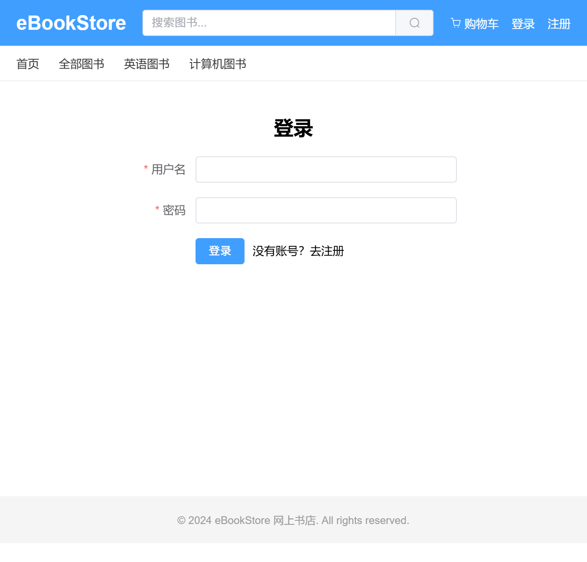

# eBookStore 网上书店

基于 Spring Boot + Vue3 的前后端分离网上书店系统，支持用户浏览/下单/支付和管理员后台管理。

## 效果展示

### 客户端首页


### 管理端仪表盘


### 管理端图书管理



## 技术栈

### 后端
- Spring Boot 3.2.7 / Java 17
- Spring Security + JWT 认证
- MyBatis-Plus 3.5.5
- MySQL 8.0
- SpringDoc OpenAPI (Swagger UI)

### 前端
- Vue 3.4 + Vue Router 4
- Vite 4.5
- Pinia 状态管理
- Element Plus 组件库
- ECharts 数据可视化
- Axios 网络请求

## 功能模块

### 客户端
- 用户注册、登录、个人信息管理
- 图书浏览（首页推荐、分类列表、新书展示）
- 图书详情、评价
- 购物车、下单结算、订单管理
- 收货地址管理
- 收藏夹
- 优惠券领取与使用
- 站内消息、公告查看

### 管理端
- 管理员登录、仪表盘
- 图书管理（增删改查、封面上传）
- 分类管理（两级分类）
- 订单管理、用户管理
- 进货记录管理
- 评价管理、留言管理
- 公告管理、优惠券管理
- 操作日志、数据统计

## 项目结构

```
eBookStore/
├── backend/                  # 后端 Spring Boot 项目
│   ├── pom.xml
│   ├── src/main/java/com/ebookstore/
│   │   ├── config/           # 配置类（Security、JWT、MyBatis-Plus、WebMvc）
│   │   ├── controller/       # 控制器（admin/ + client/）
│   │   ├── service/          # 业务层（impl/ + interf/）
│   │   ├── mapper/           # MyBatis-Plus Mapper
│   │   ├── entity/           # 实体类
│   │   ├── dto/               # 请求/响应 DTO
│   │   ├── exception/        # 全局异常处理
│   │   ├── annotation/       # 自定义注解（操作日志）
│   │   ├── aspect/           # AOP 切面
│   │   └── util/             # 工具类（JWT、Security）
│   └── src/main/resources/
│       ├── application.yml    # 配置文件
│       └── db/               # 数据库脚本
│           ├── schema.sql    # 建表语句
│           └── seed_full.sql # 种子数据（60本图书）
│
├── frontend/                 # 前端 Vue3 项目
│   ├── vite.config.js
│   ├── index.html
│   ├── package.json
│   └── src/
│       ├── api/              # API 请求（admin/ + client/）
│       ├── components/       # 公共组件
│       ├── router/           # 路由配置
│       ├── store/            # Pinia 状态管理
│       ├── utils/            # 工具（axios 封装）
│       └── views/            # 页面（admin/ + client/）
│
└── docker/
    └── docker-compose.yml
```

## 快速开始

### 环境要求

| 工具 | 版本 |
|------|------|
| JDK | 17+ |
| Maven | 3.8+ |
| Node.js | 18+ |
| MySQL | 8.0+ |

### 1. 初始化数据库

```bash
# 登录 MySQL，创建数据库
mysql -u root -p
```

```sql
CREATE DATABASE ebookstore DEFAULT CHARACTER SET utf8mb4 COLLATE utf8mb4_unicode_ci;
USE ebookstore;
SOURCE backend/src/main/resources/db/schema.sql;
SOURCE backend/src/main/resources/db/seed_full.sql;
```

### 2. 配置后端

编辑 `backend/src/main/resources/application.yml`，修改数据库密码为本机密码：

```yaml
spring:
  datasource:
    url: jdbc:mysql://localhost:3306/ebookstore?useUnicode=true&characterEncoding=utf-8&serverTimezone=Asia/Shanghai
    username: root
    password: your_mysql_password   # ← 改成你的 MySQL 密码
```

### 3. 启动后端

```bash
cd backend
mvn spring-boot:run
```

后端默认运行在 `http://localhost:8081`。

### 4. 启动前端

```bash
cd frontend
npm install
npm run dev
```

前端默认运行在 `http://localhost:5173`。

### 5. 访问系统

- 客户端：http://localhost:5173
- 管理端：http://localhost:5173/admin
- Swagger 文档：http://localhost:8081/swagger-ui/index.html

## 默认账号

| 角色 | 用户名 | 密码 |
|------|--------|------|
| 管理员 | admin | admin123 |

普通用户可通过注册页面自行创建。

## API 文档

启动后端后访问 Swagger UI：http://localhost:8081/swagger-ui/index.html

主要 API 前缀：
- `/api/client/**` — 客户端接口
- `/api/admin/**` — 管理端接口
